# AI 与人物故事账本验收

日期：2026-10-16。对应 C01、C02、C18–C21，设计与限制见 [AI 设计](ai-assistant-design.md)，使用方式见 [写作指南](writing-guide.md)。

## 环境与证据范围

首轮使用独立临时 PostgreSQL 数据库、真实本机 WsgiDAV 和本机 HTTP 模型替身。作品、API key、章节和人物都是虚构验收材料，没有读取用户作品库，也没有调用真实付费供应商。浏览器先测直接连接，再按默认 `/api` 代理方式复测；后者发现并修复了 Host 转发导致的错误拦截。后续真实 DeepSeek 连接反馈的验证单独记在本文末尾。

模型替身验证协议、上下文、结果校验与页面流程，不代表真实模型的建议质量、提示注入抵抗效果或所有供应商兼容性已经验证。代码没有赋予模型写入作品或调用工具的能力；语义复核仍不能保证识别任何模型的所有越界输出。

## 服务与数据

- 后端最终全量 351 项通过；前端最终全量 459 项通过，类型检查及生产构建通过。构建保留既有 Sass 弃用及较大分包提示。
- 专门检查配置无 key 回显、地址绑定、配置版本竞争、DNS 固定与内网拒绝、禁止重定向和重试、取消归属、会话来源、请求数量及总限时。
- 14 个动作逐一通过真实 HTTP 矩阵，9 个字段候选、4 个结构检查和写作灵感均不改持久化资料；12 条覆盖全部设定类型的资料逐字段和关联哈希一致，未保存标签及世界观关联纳入快照并校验作品归属。
- 上下文保留当前未保存稿但不保存正文；章节目标标作计划，区分当前章前后。设定模式不发送正文、创作便笺及账本来源摘录。超限明确拒绝。
- 资料指纹在生成后有效，本作人物、正文或账本变化后失效；其他作品变化不影响，跨作品目标与快照均隔离。采用前核对无模型调用。
- 无效字段、伪造来源、夹带正文、错误 JSON、截断输出或复核不通过均不产生可采用结果；没有自动付费重试。
- 账本保存有版本和幂等保护。完整本机备份、传统 WebDAV 备份及写作云同步均完成往返；人物／事件 ID 重映射，双顺序、记录历史和段落来源保留。
- 两条 WebDAV 旧包恢复入口均拒绝清空已有账本，失败前后账本不变，也未创建多余恢复副本。此前基础集成回归覆盖旧数据升级、回滚、图片、密钥轮换和服务重启。

## 页面实测

- 人物候选只修改姓名表单，其他字段不变；撤销还原原姓名，随后手工修改时撤销拒绝覆盖。取消表单后人物档案保持原值。
- 写作方向可逐条收藏、刷新后仍在；每条标明 AI 候选，保留来源、模型、生成时间和资料快照。收藏不改正文及字数。
- 新增人物伤势记录后重新打开仍在；故事时点可排除之后的状态，人物与读者分别查询。读者时点没有记录时显示无法判断。
- 来源跳转从人物页进入对应写作段落；写作页从第二章跳回第一章的来源段落时，URL 保留段落标识、正文获得焦点、账本关闭。另有真实 store、IndexedDB 与路由竞争回归，待恢复稿会阻止关闭。
- 深浅主题、Escape 关闭及 320 像素布局验证。灵感面板与账本的页面宽度均为 320，无横向溢出。
- 收藏未确认请求保留在本机；测试覆盖重复请求、409 后合并、恢复入口与原按钮一致、不同生成批次相同序号互不干扰，以及跨作品迟到响应。

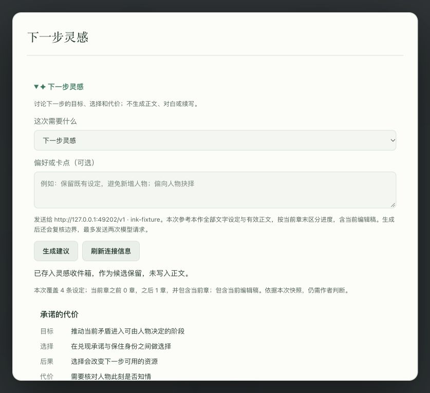

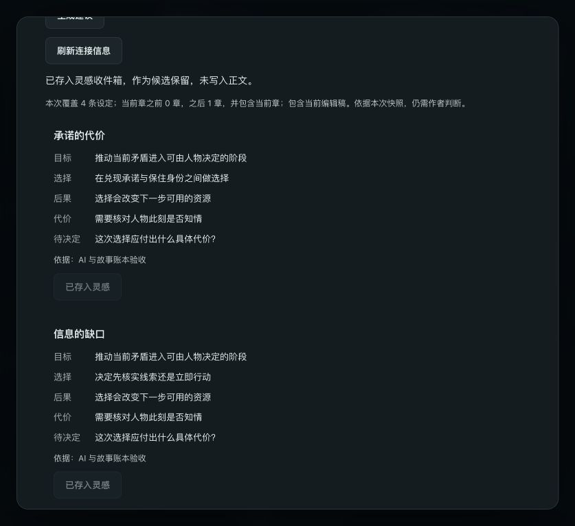

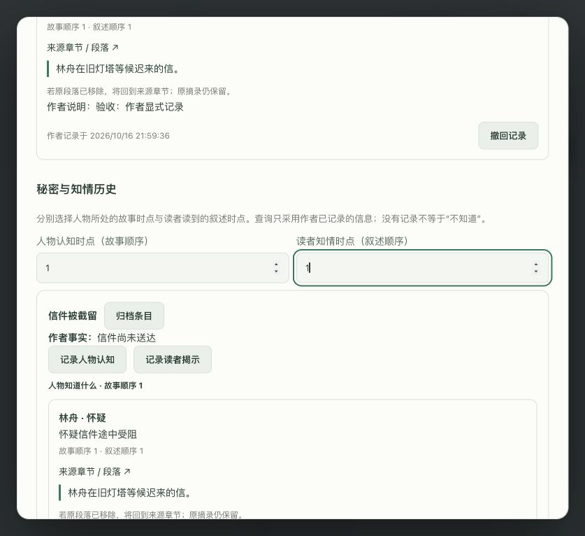

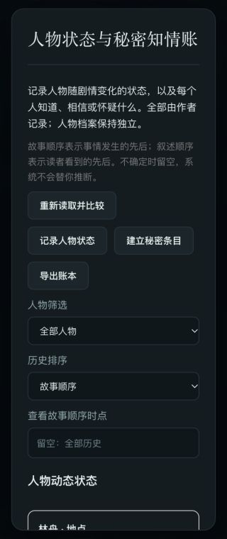

## 可重复检查

普通回归使用 `backend` 中的 `mvn test`，以及 `frontend-vue` 中的 `npm test`、`npm run build`。脚本 `scripts/integration-check.py --keep` 创建独立数据库及 WsgiDAV；为测试后端指定临时 `NOVEL_AI_CONFIG_FILE`、`NOVEL_AI_KEY_FILE` 和可信测试来源后，运行 `scripts/ai-story-check.py <run.json>`。该脚本只接受隔离环境标记，拒绝覆盖非测试模型配置。

需要浏览器验收时使用 `--keep` 保留模型替身；已有替身可用 `--existing-model-port <port>`，不会更换配置或停止模型，结果另写入临时目录。完成后停止模型、前端及后端测试进程，并用 `scripts/integration-check.py --cleanup <run.json>` 删除临时数据库。临时配置和凭据不进入仓库。

## 首轮结果

最终后端 **351/351**、前端 **459/459**、类型检查与生产构建通过，`git diff --check` 通过。超长篇分块阅读、原生其他模型协议、局域网多用户代理以及原产品清单其余未完成项不在本批交付内。

验收结束后已停止本次临时前端、后端、WsgiDAV 和模型替身，删除隔离数据库；未修改用户作品库和真实 AI 配置。

## DeepSeek 连接反馈修复

同日用户报告“服务地址解析超时”。实测系统 DNS 查询没有响应，直连也在域名解析阶段超时；通过已运行的本机 HTTP 代理可收到 DeepSeek 响应。原实现只使用系统 DNS 和直连，先前的模型替身测试无法覆盖这个实际网络环境。

- 增加显式“直连／本机代理”选项；旧配置仍为直连，代理只接受数值回环 HTTP 地址。切换保留同一服务地址绑定的加密密钥。代理停止时显示可切回直连的提示，不自动换路或重发。
- 代理解析只向 `dns.google` 发送服务域名，经固定公共 IP 建立 TLS；所有答案仍需通过公网范围检查。模型隧道 CONNECT 使用已验证的数值 IP，TLS/SNI/Host 保留原服务域名。默认系统信任库和主机名验证保持生效。代理域名解析暂只查 A 记录，IPv6-only 域名不支持。
- 原生 DNS 与代理解析分开限流，模拟两个不响应取消的原生解析后，代理仍能恢复请求；DoH 有硬总期限和取消关闭连接。补齐 DNS 附加取消时的竞争，以及代理握手取消误报连接失败的问题。
- 后端全量 **370/370**、前端 **466/466**，类型检查与生产构建通过。新增真实本机 TLS/HTTP 代理替身，覆盖数字 CONNECT、SNI/Host、错误证书、密钥不进入 CONNECT/DoH、代理失败不回退、慢滴响应总期限、取消释放和配置迁移。
- 浏览器在用户当前运行的工作室中保存本机代理 `http://127.0.0.1:7897`，沿用 `https://api.deepseek.com`、`deepseek-flash` 及已有密钥，点击一次“测试已保存的模型”，显示连接与 JSON 输出成功。测试仅发送固定连接测试句；未读取、生成或上传小说资料，未更换密钥，未修改系统网络设置。
- 没有关闭用户 VPN/代理程序。关闭后的实际公网直连取决于当时网络；“切回直连”与密钥保留已经由回归验证，不声称已测过该电脑关闭 VPN 后的外网连通性。

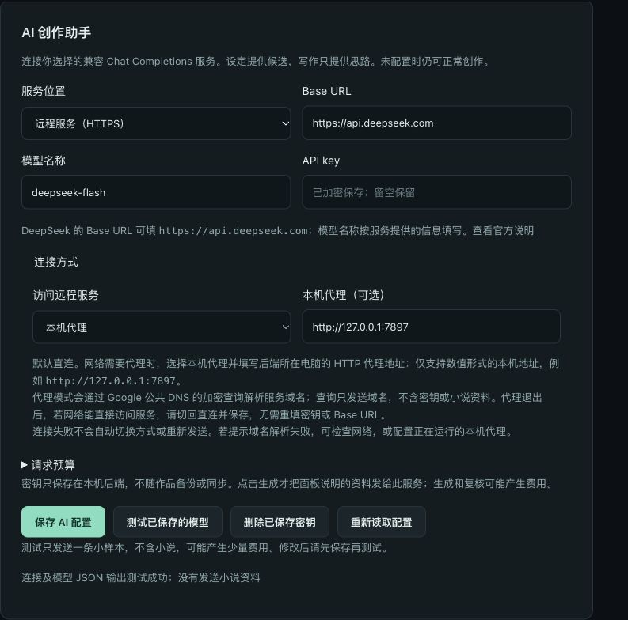

## 2026-10-18 实际网络与人物生成修复

用户再次反馈网络正常但 AI 不可用，本轮将连接测试和完整生成分别验证。以下记录为修复初期的严格复核流程；用户随后调整复核与正文范围，最终行为见下一节：

- 当前直连 DNS 返回 VPN 的 `198.18/15` 虚拟地址，原公网检查拒绝该地址。现在只对这类虚拟地址进行固定公共 DNS 的加密查询，再验证并固定公网目标；私网、回环、保留地址、重定向和证书检查仍保留，不把虚拟地址直接当公网放行。浏览器通过当前 `/api` 路径的连接及 JSON 小样本测试通过。
- 实际 `deepseek-flash` 生成出现思考内容耗尽输出预算。对官方 DeepSeek 的明确适配模型使用非思考 JSON 输出，不增加用户预算，也不对其他兼容服务猜测供应商参数。边界复核提示同时明确 JSON 输出要求。
- 提示中显式提供允许引用的来源标识，要求逐字选择；未提供的序章正文不得补造章节来源。结构、来源和边界检查保持严格，截断、空结果、错误 JSON、字段/来源问题和复核拒绝分别给出固定错误说明，不回显失败原文、不自动付费重试。
- 获得用户对当前作品文字设定及指定人物表单发送到已配置 DeepSeek 的授权后，真实人物生成曾在校验层失败；经过修复，最终在人物编辑页选择「构思性格」，以“依据已提供的背景构思此人物性格。”完成生成与独立复核，显示 **3 个可采用候选、5 条设定覆盖和 7 条参考资料**。此过程不发送整部正文。
- 页面验证「采用到性格草稿」只修改当前表单。未点击保存，重新打开人物后性格仍为空，角色和背景保持原值。候选依然需要作者核对，成功返回不证明所有模型推断正确，也不代表全部任务都已在真实供应商上逐项验收。
- AI 相关回归 **77/77** 通过；14 个动作已有本机 HTTP 替身矩阵覆盖。最终全量测试和本轮界面结果记录在 [产品 case 清单](product-cases.md)。

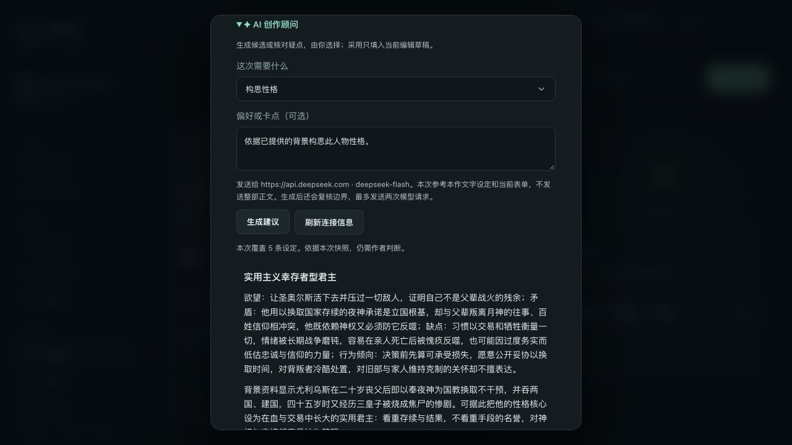

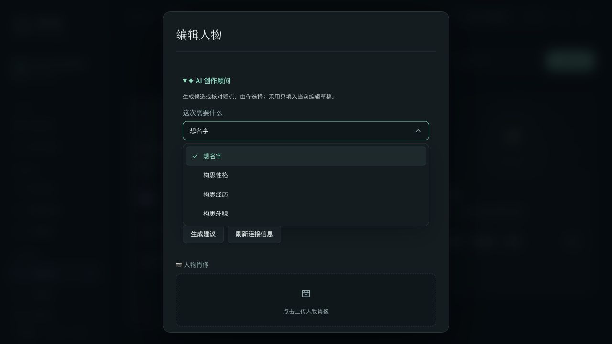

## 2026-10-18 分级复核、参考正文与界面验收

- 严格的正文／对白边界与独立语义复核仅用于写作工作台。设定和结构建议保留可采用结构、字段长度与资料来源检查，不因合理的设定创作而拒绝。检查失败时把失败候选及固定诊断追加到原对话，保留原资料和请求，只修正一轮；设定最多 2 次模型请求，写作最多 4 次。网络、鉴权、取消和超时不自动重发，未知用量明确标记。
- 设定界面新增可选参考正文，默认不选。仅加载章节标题和字数供用户选择；生成时重新读取勾选章节的已保存正文，合计最多 10,000 字，计数与编辑器一致（中日韩逐字、英文按词），不截断。另有总输入字符预算，仍可能先达到配置的预算上限。未勾选正文、未保存写作稿、创作便笺及章节摘要不混入选章内容；参考正文不代表当前故事推进时点。
- 隔离 HTTP 联测覆盖全部 14 个动作，共 32 次模型替身请求；确认首轮和修正轮调用数、四条消息保留原上下文、复核失败理由、第二轮停止及取消边界。C25 验证恰好 10,000 字完整提供、10,001 字零模型调用、无字数但超总字符预算拒绝、默认与空选择等价、跨作／回收站／重复章节拒绝。选择或所选正文变化使采用快照失效，未选正文变化不影响设定快照。
- 使用独立 PostgreSQL 数据库与 WsgiDAV，原备份和云同步回归通过。测试配置和密钥均在临时目录；结束后删除临时数据库，8081/8099 无监听。此阶段没有调用真实 DeepSeek，没有新增用户正文上传，不将替身测试表述为真实模型质量验证。
- 前端全量 **616/616**、类型检查、生产构建通过；后端全量 **397/397**、AI **94/94**，最终参考时点说明调整后 Context **18/18** 通过。构建保留既有写作页较大分包提示。
- 真实页面验证人物编辑里的章节勾选与合计数、清空、关闭保护及焦点恢复；390 像素下窗口与页面无横向溢出，操作按钮并排。其他界面回归包括目录的新建／管理、篇卷顺序边界、深浅主题、相邻模块转场、关系图及地图缩放和拖拽；拖动不误建，普通点击仍能打开正确节点。未保存测试编辑到用户作品。

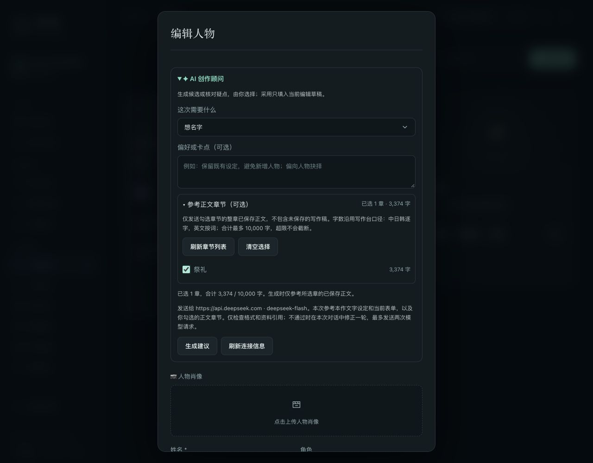

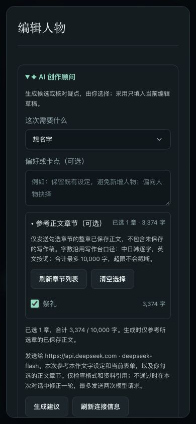

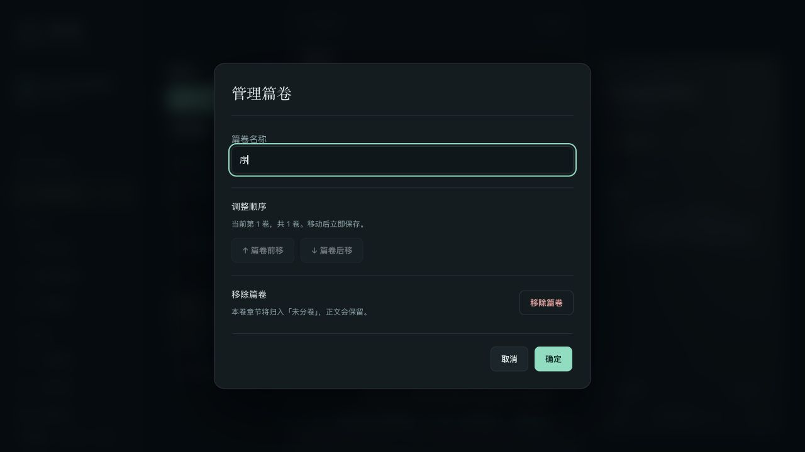

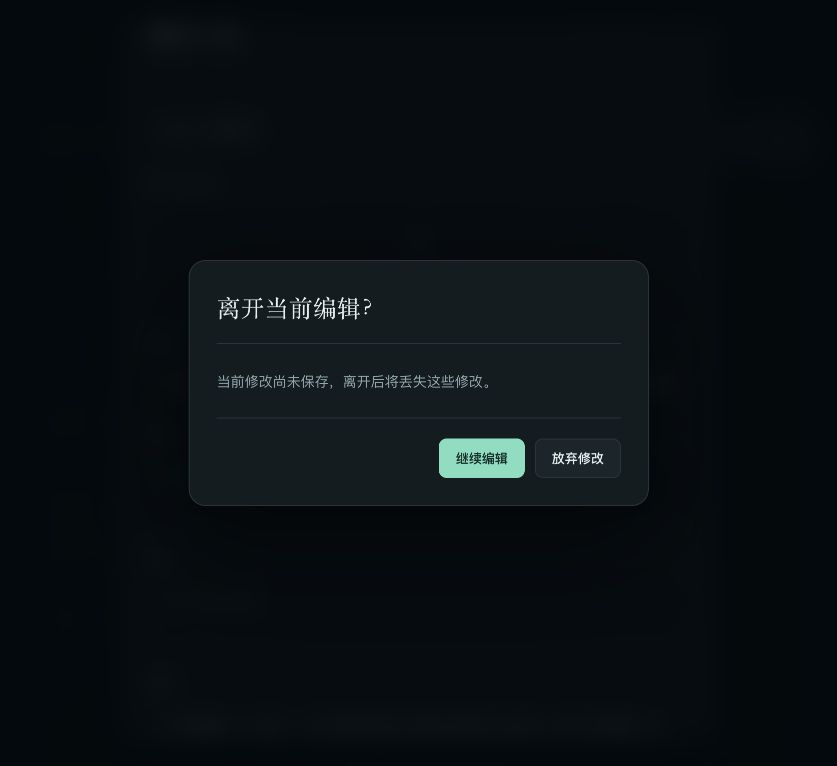

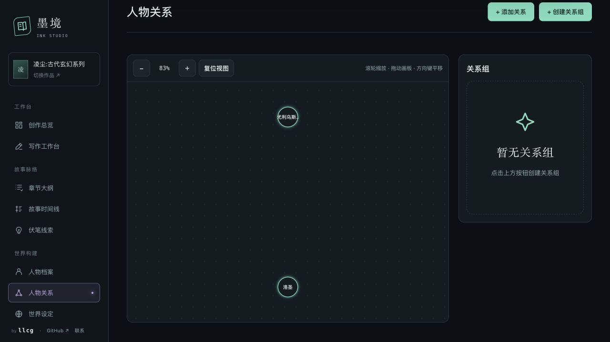

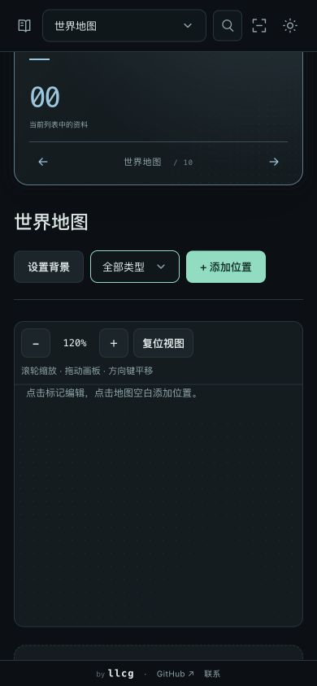
